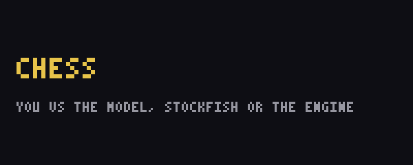

# Hermes Arcade

Three games inside the terminal Hermes already runs in:

- **Chess** against the model Hermes is running, the built-in engine, or
  Stockfish. The standalone `console` CLI can also use an installed agent CLI
  (Claude Code, Codex, OpenCode).
- **Kart**, a side-view racer with three rivals, boost pads, oil slicks, coins,
  slipstream, a drift charge, checkpoint gates and three times of day. Race it
  yourself, or let a model write the controller and score it.
- **Dino**, Chrome's offline runner wearing the Hermes cap, hidden as an easter
  egg.



[45-second demo, sound on](docs/demo-45s.mp4)

`/console` opens the arcade. `Esc` returns to Hermes exactly where you left it.

## Install

```bash
hermes plugins install Takumixbt/Hermes-Arcade --enable
```

Restart Hermes. `/help` lists `/console` and `/race`.

From a checkout, a directory junction is enough on Windows (no admin rights):

```powershell
$dst = "$env:LOCALAPPDATA\hermes\plugins\hermes-arcade-tui"
New-Item -ItemType Directory -Force -Path (Split-Path $dst) | Out-Null
cmd /c mklink /J "$dst" "C:\path\to\Hermes-Arcade"
hermes plugins enable hermes-arcade-tui
```

## Play

```text
/console            chess, the default
/console kart       the racer
/console dino       the easter egg
```

Kart controls: `Up`/`Down` lane, `Right` accelerate, `Left` brake, `Space` start
or restart. Chess is driven by the menus: pick an opponent, then move.

## Race a model

```text
/race                        the model Hermes is running writes the controller
/race opencode-go/deepseek-v4.1-flash    a specific provider/model
```

The model is asked for one function:

```python
def act(state):
    return {"lane": 1, "throttle": 1.0}
```

`state` carries distance, speed, lane, rank, the next pad and the rivals. The
engine runs that controller at 60 fps on a fixed seed and reports distance,
place, time and average speed, so two models can be compared on the same track.
The controller runs in a child process with a wall-clock cap; a broken policy
cannot take Hermes down.

## Who you play in chess

The opponent menu lists what this machine actually has:

- **Engine** and **Stockfish** (local, no network)
- **Hermes model**, optionally with any provider/model this install has
  credentials for, read from `config.yaml` plus Hermes's models.dev cache
- **Agent CLIs** found on `PATH` (`claude -p`, `codex exec`, `opencode run`),
  using the login already on the machine

Inside the Hermes window the menu stays on the Hermes model, the engine and
Stockfish. The standalone `console` CLI also lists the agent CLIs and an API
endpoint.

## What it touches

- While hosted in Hermes, model calls go through `ctx.llm`. A spawned game
  window reaches it over a loopback-only bridge (random port, bearer token) and
  receives no provider key. `/race`'s model-written controller gets neither
  the bridge token nor a key.
- Model-written kart controllers execute as Python in a child process. That is
  arbitrary code by design; run `/race` only with models you would let run code.
- Games draw with sixel graphics when the terminal supports it (Windows Terminal
  1.22+, WezTerm, iTerm2, foot). Everywhere else — VS Code, Cursor, any xterm.js
  panel — the arcade falls back to ANSI truecolor half-blocks at lower
  resolution, so it still plays. `CONSOLE_SIXEL=1` forces sixel, `0` forces text.
- High scores and game state stay in the plugin's own data directory.

## Layout

```text
console/games/chess/    rules, engine, Stockfish and model opponents
console/games/kart/     physics, rendering, headless policy benchmark
console/games/dino/     Chrome's trex port and the Hermes sprite sheet
console/gfx/            sixel encoder, PNG codec, canvas
console/hermes_plugin.py  /console, /race
```

## Credits

The dino is a faithful port of Chromium's `offline.js`/`trex.ts`, MIT licensed,
with a reskinned sprite sheet. Chess rules and the engine are this project's own.
